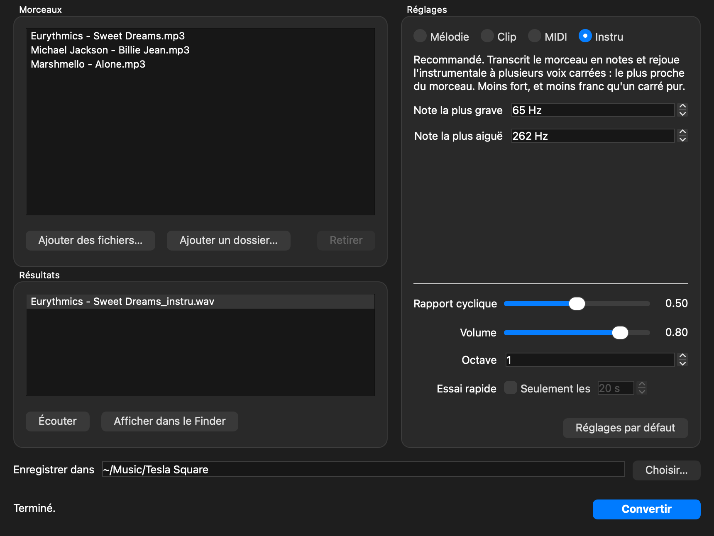
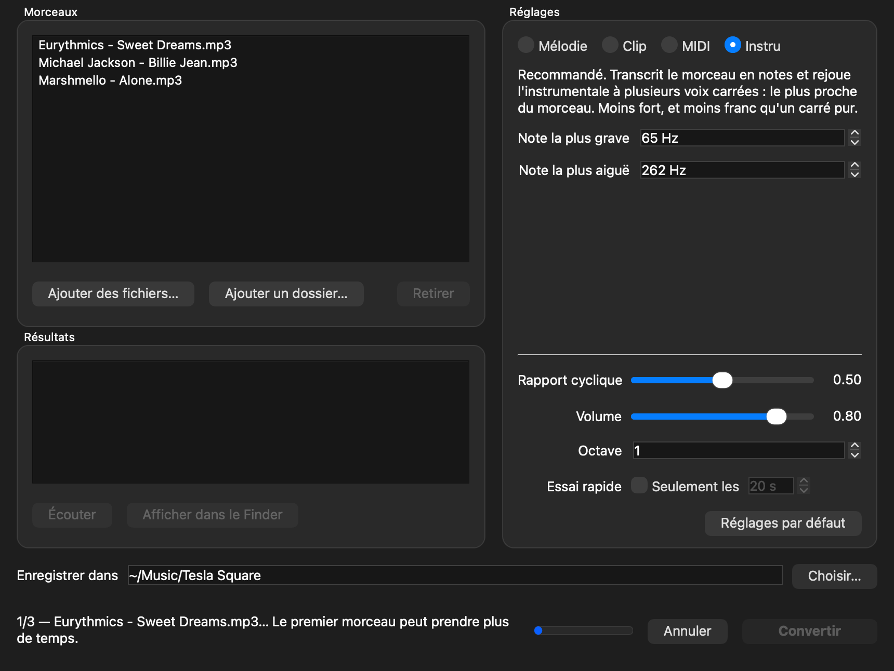
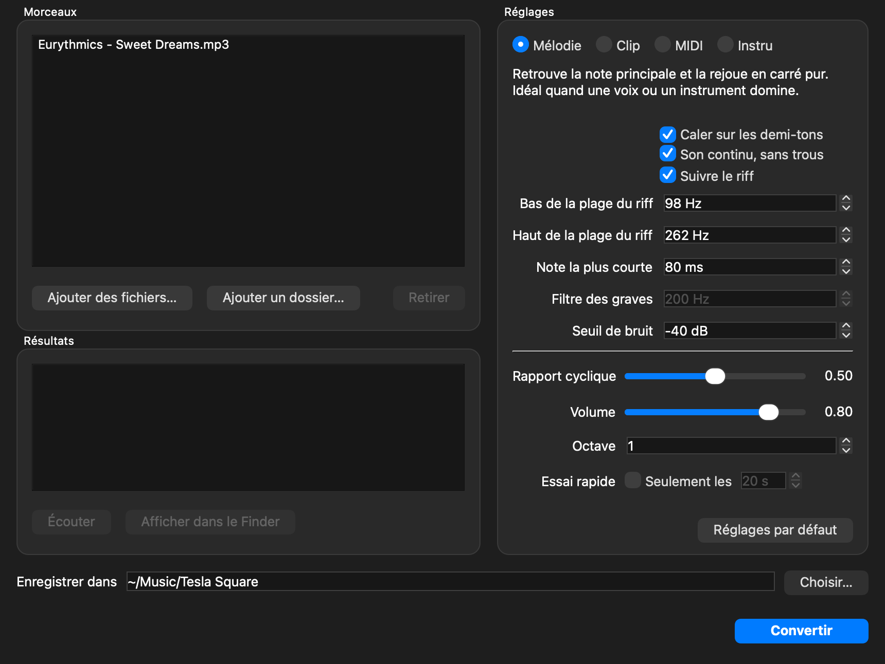

# Tesla Square

**De la musique pour bobine Tesla.** Tesla Square convertit un MP3 (ou un MIDI) en signal carré pour
une petite bobine Tesla musicale Bluetooth (SSTC de bureau) : la bobine chante le morceau avec ses arcs.
Une application Mac à glisser-déposer, et un outil en ligne de commande.

*English summary below.*

<!-- Photo de la bobine : déposer le fichier dans docs/images/bobine.jpg puis retirer ce commentaire.

-->

| Mode Instru | Conversion en cours | Mode Mélodie |
|---|---|---|
|  |  |  |

## Pourquoi un signal carré ?

Une bobine Tesla musicale ne joue pas un son comme un haut-parleur : elle allume et éteint ses arcs au
rythme du signal. Elle rend très bien un carré franc à deux niveaux, idéalement une seule note à la
fois, et très mal un morceau mixé, qui donne surtout du grésillement. Tesla Square reconstruit donc
le morceau en notes, puis le rejoue en carré.

## Les modes

| Mode | Principe | Rendu |
|---|---|---|
| **Instru** (conseillé) | Transcrit le morceau en notes avec [basic-pitch](https://github.com/spotify/basic-pitch), garde la plage de l'instrumentale, rejoue plusieurs voix carrées | Le plus proche du morceau |
| **Mélodie** | Suit une seule note (la mélodie, ou le riff avec « Suivre le riff ») et la rejoue en carré pur | Carré franc, mais une note à la fois |
| **Clip** | Passe-bande, compression, écrêtage en carré | Immédiat, garde le rythme plus que les notes |
| **MIDI** | Rejoue un fichier `.mid` | Le plus net si on a la partition |

Sortie : WAV mono, 44,1 kHz, 16 bits. On le lit sur le Mac, qui l'envoie en Bluetooth à la bobine.

## Application Mac (sans terminal)

Compile-la une fois (voir ci-dessous), puis ouvre **Tesla Square** depuis le dossier Applications. Glisse tes morceaux dans la fenêtre, choisis un
mode, puis clique sur **Convertir**. Les résultats s'écoutent directement dans la fenêtre. Ils sont
enregistrés par défaut dans `~/Music/Tesla Square`.

L'application n'a besoin ni de Python ni de ffmpeg : elle utilise `afconvert`, fourni avec macOS, si
ffmpeg est absent. **Instru** est le mode conseillé : il transcrit le morceau en notes et rejoue
l'instrumentale à plusieurs voix carrées. Le mode MIDI, lui, ne lit que les fichiers `.mid`.

Pour la compiler, il faut un Mac Apple Silicon, Python 3 (3.14 testé) et le Python 3.9 fourni avec
macOS (`/usr/bin/python3`, pour le transcripteur basic-pitch). Le script passe les tests, compile,
vérifie l'application obtenue, puis l'installe dans `/Applications` :

```bash
./compiler_app.sh
```

Elle est compilée pour Apple Silicon et signée localement, sans notarisation Apple. Elle s'ouvre
normalement sur ce Mac. Copiée sur un autre Mac, elle sera bloquée au premier lancement : il faudra
l'autoriser dans Réglages Système > Confidentialité et sécurité.

La compilation se fait dans `~/Library/Caches/TeslaSquare`, hors du projet. Sur un Bureau synchronisé
avec iCloud, les fichiers de `.venv` peuvent devenir « cachés », et Qt ne trouve alors plus ses modules.
C'est pourquoi `.venv` ne contient pas PySide6 et que ses tests d'interface sont ignorés : ils sont
lancés par `compiler_app.sh`.

## Ligne de commande : installation

```bash
brew install ffmpeg   # si besoin
cd tesla_square
python3 -m venv .venv
.venv/bin/pip install -r requirements.txt
```

Testé sur macOS Apple Silicon avec Python 3.14 et ffmpeg 8.0. Sans ffmpeg, `afconvert` prend le relais.

## Utilisation

```bash
source .venv/bin/activate

# Mélodie (recommandé pour une chanson)
python tesla_square.py ma_chanson.mp3 --mode melodie --quantize

# Rapide, garde le rythme et la texture, moins lisible musicalement
python tesla_square.py ma_chanson.mp3 --mode clip

# Depuis un fichier MIDI : le meilleur rendu si tu en as un
python tesla_square.py ma_chanson.mid --mode midi

# Essai rapide sur 20 s, avec écoute immédiate
python tesla_square.py ma_chanson.mp3 --mode melodie --quantize --preview 20 --play

# Tout un dossier
python tesla_square.py ~/Music/a_convertir --mode melodie --quantize
```

Baisse le volume de la bobine avant `--play` : la lecture démarre dès la fin de la conversion.

## Mode instru

Dans l'application : MP3 → transcription en MIDI (basic-pitch) → notes de 65 à 262 Hz seulement, pour
retirer le gros de la voix → silences comblés → plusieurs voix carrées. En cliquant sur Instru, l'octave
passe à +1. Le résultat est plus proche du morceau, mais moins fort et moins franc qu'un carré pur, car
le mélange de plusieurs voix n'a plus deux niveaux. La plage dépend du morceau : à ajuster si la voix
reste trop présente ou si l'instrumentale perd ses aigus.

En ligne de commande, il faut le venv basic-pitch décrit plus bas :
`.venv-bp/bin/python -W ignore tesla_square.py ma_chanson.mp3 --mode instru --octave 1`

## Détail des modes en ligne de commande

| Mode | Principe | À utiliser pour |
|---|---|---|
| `melodie` | Détecte la note principale (pYIN) et resynthétise un carré pur | Une voix ou un instrument bien en avant |
| `clip` | Passe-bande, compression, écrêtage en carré | Un rendu immédiat, ou un morceau sans mélodie claire |
| `midi` | Synthétise les notes d'un MIDI, la plus aiguë à chaque instant | Une partition propre, le rendu le plus net |

Sans `--mode`, un fichier `.mid` passe en `midi` et un fichier audio en `melodie`.

## Options

| Option | Modes | Défaut | Effet |
|---|---|---|---|
| `--duty` | tous | 0.5 | Rapport cyclique ; 0.1–0.3 donne un son plus fin sur certaines bobines |
| `--volume` | tous | 0.8 | Niveau de sortie, plafonné à 0.95 |
| `--preview N` | tous | | Ne traite que les N premières secondes |
| `--play` | tous | | Lit le résultat avec `afplay` |
| `--sortie` | tous | `sortie` | Dossier de sortie |
| `--gate` | clip, melodie | -40 | Seuil de bruit en dB : en dessous, silence total |
| `--low`, `--high` | clip | 300, 3000 | Bande conservée, en Hz |
| `--min-note` | melodie | 60 | Durée minimale d'une note, en ms |
| `--quantize` | melodie | | Cale les notes sur le demi-ton le plus proche |
| `--hp-analyse` | melodie | 200 | Passe-haut avant détection, en Hz (0 pour le couper) |
| `--continu`, `--no-continu` | melodie | activé | Tient chaque note jusqu'à la suivante ; seul un vrai silence du morceau (0,3 s ou plus sous `--gate`) coupe le son |
| `--riff` | melodie | | Suit la note la plus forte de la plage ci-dessous, au lieu de la mélodie |
| `--riff-bas`, `--riff-haut` | melodie | 98, 262 | Plage du riff, en Hz ; à arrêter sous la voix |
| `--octave` | melodie, midi | 0 | Transposition, de -3 à +3 octaves |
| `--poly` | midi | | Mélange plusieurs voix carrées |

## Si le résultat ne ressemble pas à la mélodie

La détection suit une seule note. Elle marche bien quand la mélodie domine, et mal quand elle est
noyée dans l'accompagnement : un mix très chargé peut donner de mauvaises notes. Dans l'ordre :

1. **La mélodie est aiguë mais l'outil suit les accords** : essaie `--hp-analyse 400` ou `500`.
2. **La mélodie est grave** (voix d'homme) : essaie `--hp-analyse 100`, ou `0`.
3. **Trop de notes parasites** : monte `--min-note` à 100 ou 150.
4. **Notes manquantes** : baisse `--gate`, par exemple à `-50`.
5. **Le morceau repose sur un riff répété** (Sweet Dreams, par exemple) : essaie `--riff`, et règle
   `--riff-bas` et `--riff-haut` pour que la plage couvre le riff et s'arrête sous la voix.
6. **Morceau trop dense** : isole d'abord la voix avec un séparateur de pistes (Demucs, par exemple)
   et donne la piste de voix à l'outil, ou cherche un fichier MIDI du morceau.

## Mode midi depuis un fichier audio (basic-pitch, optionnel)

`basic-pitch` transcrit un fichier audio en MIDI, mais il ne s'installe pas avec Python 3.14. Il lui
faut un Python plus ancien, dans un venv séparé. Le Python 3.9 fourni avec macOS convient, et cette
installation a été testée :

```bash
/usr/bin/python3 -m venv .venv-bp
.venv-bp/bin/pip install --only-binary=:all: basic-pitch tqdm soundfile
.venv-bp/bin/python -W ignore tesla_square.py ma_chanson.mp3 --mode midi
```

Sans cela, le mode `midi` accepte les fichiers `.mid` et affiche une erreur explicite pour l'audio.

## Bon à savoir

- **Rapport cyclique** : pour `--duty` différent de 0.5, les deux niveaux du carré ne sont pas
  symétriques (par exemple +0.8 et -0.2 à 0.2). C'est voulu : le signal reste de moyenne nulle, sans
  composante continue, ce qui évite un « toc » à chaque départ de note.
- **Fondus** : les 20 ms de début et de fin passent par des niveaux intermédiaires. Le signal est
  binaire partout ailleurs, sauf avec `--poly`, qui mélange forcément plusieurs niveaux.
- **Bluetooth** : le codec (AAC ou SBC) compresse le son, donc le carré qui arrive à la bobine n'est
  plus parfaitement net. Le volume du Mac joue aussi : si le son est faible ou haché, ajuste-le.
- **MIDI** : les variations de hauteur (pitch bend) sont ignorées et les batteries sont retirées.
- **Dossiers** : seul le contenu direct du dossier est traité, sans ses sous-dossiers. Si deux
  fichiers portent le même nom (`a.mp3` et `a.flac`), le second est ignoré et signalé.

## Tests

```bash
.venv/bin/python -m pytest -v   # moteur (les tests d'interface sont lancés par compiler_app.sh)
```

## License

MIT, voir [LICENSE](LICENSE). L'application compilée embarque basic-pitch (Spotify, Apache 2.0).

## English summary

Tesla Square turns music into a square wave for a small Bluetooth musical Tesla coil (desktop SSTC),
so the coil plays the song with its arcs. Coils render a clean two-level square wave well and a mixed
song badly, so the tool rebuilds the song as notes first.

- **Instru** (recommended): transcribes the song to MIDI with basic-pitch, keeps the instrumental range
  (65–262 Hz by default, which drops most of the vocals), fills the gaps and plays several square voices.
- **Mélodie**: follows a single note (pYIN, or the strongest note of a riff) and plays a pure square.
- **Clip**: band-pass, compression and hard clipping. **MIDI**: plays a `.mid` file.

A drag-and-drop macOS app (PySide6, built with `./compiler_app.sh` on Apple Silicon) and a command-line
tool (`tesla_square.py --help`). The interface and the docs are in French.
